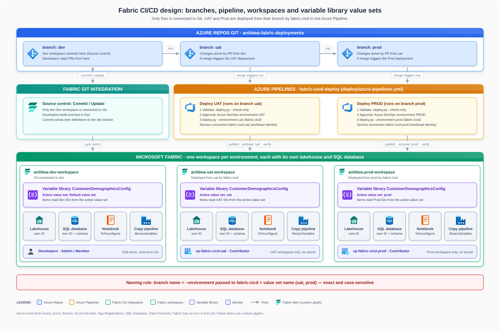
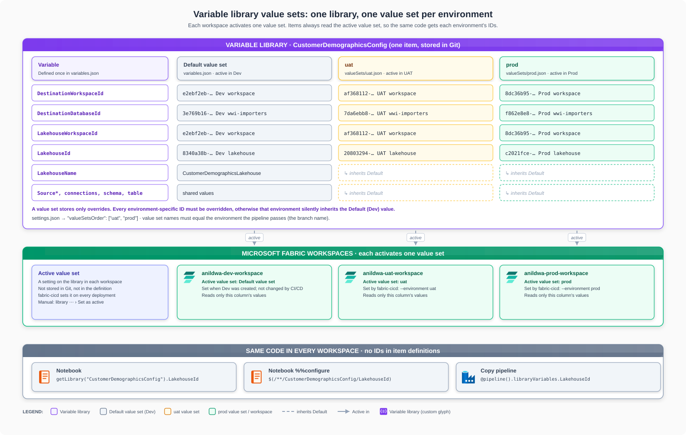
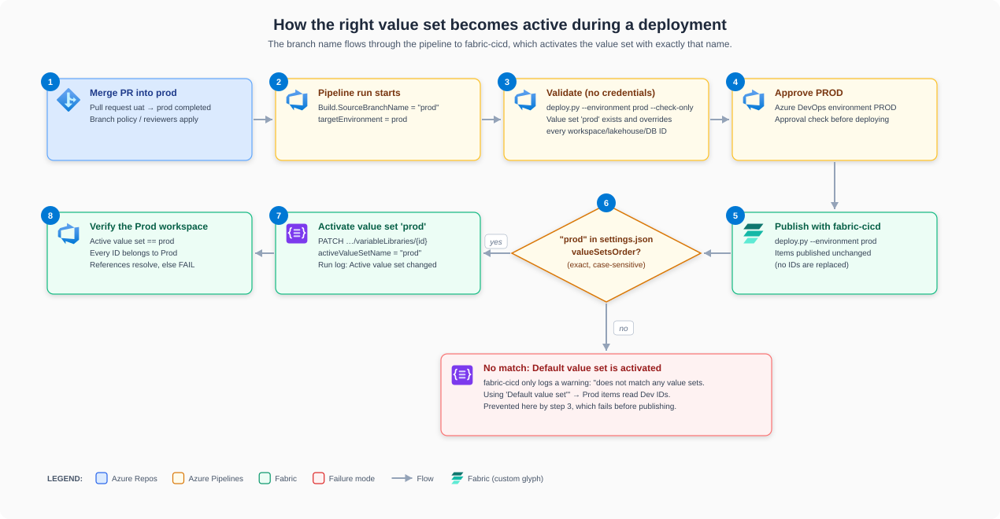
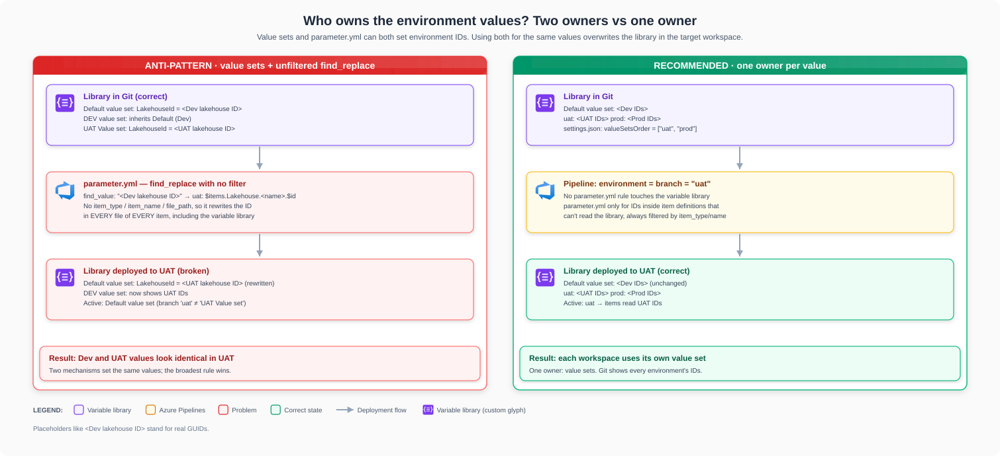

# Fabric CI/CD design guide: workspaces, variable libraries, branches, and pipelines

This guide describes how this repository promotes Microsoft Fabric items from Dev to UAT
and Prod with Azure DevOps and [fabric-cicd](https://microsoft.github.io/fabric-cicd/), and
why it is designed this way. It reflects the working setup in this repository and the
lessons from fixing variable library values that were overwritten during deployment.

For the step-by-step tenant settings, workspace permissions, federated Azure DevOps
service connections, and approval setup, see
[Connect Azure DevOps to Fabric](../README.md#connect-azure-devops-to-fabric).

## Design principles

1. **One workspace per environment.** Dev, UAT, and Prod each have their own lakehouse and
   SQL database. Only the Dev workspace is connected to Git.
2. **One branch per environment.** Changes move `dev` → `uat` → `prod` by pull request. A
   merge into `uat` or `prod` starts the deployment for that environment.
3. **One variable library, one value set per environment.** The library holds every
   environment's IDs. Each workspace activates its own value set, and items read IDs from
   the active value set at run time.
4. **Branch name = environment = value set name.** The pipeline passes the branch name to
   fabric-cicd, which activates the value set with exactly that name.
5. **One owner per value.** Value sets own environment IDs. `parameter.yml` is only for IDs
   embedded in item definitions that can't read the library, and its rules are always
   filtered so they never touch the variable library.
6. **Verify, don't rewrite.** The pipeline checks that every environment value is correct and
   fails the deployment if it isn't. Git stays the single source of truth.

## 1. Architecture

| Environment | Git branch | Fabric workspace | Active value set | Deployed by | Approval |
|---|---|---|---|---|---|
| Dev | `dev` | `anildwa-dev-workspace` | Default value set | Fabric Git integration (developers) | Pull request review |
| UAT | `uat` | `anildwa-uat-workspace` | `uat` | Pipeline `fabric-cicd-deploy`, service connection `fabric-cicd-uat` (`sp-fabric-cicd-uat`) | Azure DevOps environment **UAT** |
| Prod | `prod` | `anildwa-prod-workspace` | `prod` | Pipeline `fabric-cicd-deploy`, service connection `fabric-cicd-prod` (`sp-fabric-cicd-prod`) | Azure DevOps environment **PROD** |

- **Only Dev is Git-connected.** Developers commit from Fabric **Source control** to `dev`.
  UAT and Prod are never edited directly; they are deployed from their branch.
- **One pipeline, selected by branch.** [deploy/azure-pipelines.yml](../deploy/azure-pipelines.yml)
  reads `Build.SourceBranchName` and picks the environment, workspace, service connection,
  and approval environment. Runs from any other branch fail.
- **Least privilege.** Each service principal uses workload identity federation (no secret),
  and is **Contributor** on its own workspace only. Fabric API authorization does not use
  Azure subscription RBAC; a subscription-scoped Azure DevOps service connection can
  separately require read access for its Azure CLI login.

## 2. Variable library value sets

A **value set** is a named set of values for the library's variables, typically one per
environment. Think of the library as a table: the **Default value set** is the first column,
and each value set adds another column.

| File in Git | What it holds |
|---|---|
| `variables.json` | Variable names, types, and the **Default value set** values (Dev) |
| `valueSets/uat.json` | Only the variables that differ in UAT (`variableOverrides`) |
| `valueSets/prod.json` | Only the variables that differ in Prod |
| `settings.json` | `valueSetsOrder`: the value set names, for example `["uat", "prod"]` |

Key behaviors:

- **A value set stores only overrides.** A variable it doesn't override uses the Default (Dev)
  value. Every workspace, lakehouse, and database ID must therefore be overridden in every
  environment's value set.
- **The active value set is a setting on the library in each workspace.** It isn't stored in
  Git or in the item definition. Each workspace has exactly one active value set.
- **Items always read the active value set.** The same code returns each environment's IDs:

  | Consumer | How it reads the library |
  |---|---|
  | Notebook code | `notebookutils.variableLibrary.getLibrary("CustomerDemographicsConfig").LakehouseId` |
  | Notebook default lakehouse | `%%configure` with `$(/**/CustomerDemographicsConfig/LakehouseId)` in the first code cell |
  | Data pipeline | `@pipeline().libraryVariables.LakehouseId` (bound in the pipeline's `libraryVariables`) |

## 3. How the value set is activated

1. A pull request is merged into `prod`.
2. The pipeline sets `targetEnvironment` from `Build.SourceBranchName` (`prod`).
3. The **Validate** stage runs `deploy.py --check-only`. It fails if the `prod` value set is
   missing, named differently, or doesn't override every environment-specific ID.
4. The **PROD** approval is granted.
5. `deploy.py --environment prod` publishes the items with fabric-cicd, unchanged.
6. fabric-cicd checks whether `prod` is in `settings.json` → `valueSetsOrder`.
7. If it is, fabric-cicd calls the Fabric API to set `activeValueSetName` to `prod`.
8. `deploy.py` verifies that `prod` is active and every ID belongs to the Prod workspace.

The match in step 6 is **exact and case-sensitive**. If no value set matches, fabric-cicd
activates the **Default value set** (Dev IDs) and only logs a warning:
`Provided target environment 'prod' does not match any value sets. Using 'Default value set'`.
That's why step 3 fails the run first.

Sources: [fabric-cicd: Variable Library](https://microsoft.github.io/fabric-cicd/latest/reference/item_types/#variable-library)
("The active value set of the variable library is defined by the `environment` field"),
[Microsoft Learn: End-to-end automation](https://learn.microsoft.com/en-us/fabric/cicd/tutorial-end-to-end-automation#extend-this-tutorial)
("activate the value set that matches the `--environment` you pass"), and the fabric-cicd
code (`_items/_variablelibrary.py`) for the exact-match and fallback behavior.

You can also change the active value set manually (library **…** › **Set as active**) or with
the Fabric REST API. The next deployment sets it again. Per the fabric-cicd docs, if a
workspace's **active** value set is renamed or removed, the deployment fails; switch that
workspace to another value set in the Fabric UI first.

## 4. When to use `parameter.yml` and `find_replace`

`parameter.yml` rewrites item definitions while fabric-cicd publishes them. It and value sets
can both set environment IDs; using both for the same values creates two owners, and the
broadest rule wins. An unfiltered `find_replace` rule applies to **every file of every item**,
including the variable library, so it rewrites the library's Default and Dev values in the
target workspace.

| Situation | Use |
|---|---|
| IDs that notebooks, pipelines, or other items can read from the library at run time | **Value sets** (this repository) |
| A notebook's default lakehouse | **`%%configure` from the library** (this repository); or a `find_replace` rule filtered to `item_type: Notebook` |
| IDs embedded in definitions that can't read the library (for example semantic model connections) | **`parameter.yml`**, with `item_type` / `item_name` / `file_path` filters and `$items` / `$workspace` tokens |
| A library with only the Default value set (no value sets) | `key_value_replace` on `$.variables[?(@.name=="…")].value`, filtered to the library. A valid alternative, but don't mix it with value sets |

Rules for `parameter.yml`:

- **Always filter** every rule with `item_type`, `item_name`, or `file_path`. Filters only
  include; there's no exclude, so list the item types that contain the ID.
- **Never let a rule touch `VariableLibrary`** when value sets own the values.
- **`$items.<Type>.<Name>.$id` resolves only to items that already exist** in the target
  workspace; publish order matters.
- **Keep `find_value` current.** A `find_value` that no longer appears replaces nothing and
  silently ships Dev IDs.

## 5. Release process

1. Develop and test in `anildwa-dev-workspace`.
2. In Fabric, open **Source control** and commit to `dev`.
3. Create a pull request `dev` → `uat` and complete it. The pipeline validates, waits for the
   **UAT** approval, deploys, and verifies.
4. Test in UAT. Then create a pull request `uat` → `prod` and complete it; the pipeline does
   the same for **PROD**.

**Add an environment-specific variable:** add it in the Dev library and set its UAT and Prod
values in the `uat` and `prod` value sets before committing. Validation fails if a value set
doesn't override it.

**Add a new environment** (for example `test`):

1. Create the workspace, a service principal and service connection for it (workload identity,
   Contributor on that workspace only), and an Azure DevOps environment with an approval.
2. In the pipeline YAML, add the branch to `trigger.branches.include` and add its variables
   block (workspace ID, service connection, approval environment).
3. Create the lakehouse and SQL database by running the pipeline manually with
   `items_in_scope` = `Lakehouse,SQLDatabase`, so their IDs exist.
4. In the Dev library, add a value set named exactly like the branch with the new IDs, commit,
   and promote as usual.

## 6. Pipeline guardrails

[deploy/deploy.py](../deploy/deploy.py) enforces the design:

| Stage | Fails when |
|---|---|
| Validate (no credentials) | No value set is named exactly like the environment |
| | The value set doesn't override a workspace, lakehouse, or database ID |
| | Two value sets share an ID (for example a copy-pasted UAT ID in `prod`) |
| | A notebook, pipeline, lakehouse, or SQL project contains a hard-coded ID |
| | A notebook or pipeline references a library variable that doesn't exist |
| Deploy | Publishing fails, or the SQL project schema can't be applied |
| Verify (after publishing) | The active value set isn't the environment |
| | An ID in the active value set doesn't belong to the target workspace |
| | An item references an ID outside the target workspace, or a binding doesn't resolve |
| | A SQL schema object is missing |

## 7. Troubleshooting

| Symptom | Cause | Fix |
|---|---|---|
| Dev and UAT values look identical in the UAT library | An unfiltered `find_replace` rule rewrote the library | Filter the rule to the item types that need it; let value sets own the IDs |
| UAT or Prod has **Default value set** active | Value set name doesn't exactly match the environment (`UAT` vs `uat`, `UAT Value set`) | Rename the value set to the branch name, or map branch to name in the pipeline |
| One variable reads the Dev value in UAT | The `uat` value set doesn't override it | Add the override; validation catches this |
| Deployment fails after renaming or removing a value set | That value set is active in the target workspace | Switch the workspace to another value set in the Fabric UI, then redeploy |
| SQL database deployed without tables | fabric-cicd 1.4.0 creates SQL databases without their definition | `deploy.py` deploys the SQL project schema after publishing |
| Notebook in UAT is attached to the Dev lakehouse | The lakehouse ID is stored in the notebook's metadata | Attach it with `%%configure` from the library |
| UAT/Prod notebook fails with `403 AuthorizationFailure` reading ADLS | The storage account blocks public network access; only Dev has a network path | Give each workspace network access (for example a managed private endpoint) |
| An item deleted in Git still exists in UAT or Prod | Orphan cleanup is disabled | Delete it manually |

## References

- [Introduction to CI/CD in Microsoft Fabric](https://learn.microsoft.com/en-us/fabric/cicd/cicd-overview)
- [Tutorial: End-to-end automation in Fabric](https://learn.microsoft.com/en-us/fabric/cicd/tutorial-end-to-end-automation)
- [Lifecycle management of the Variable library](https://learn.microsoft.com/en-us/fabric/cicd/variable-library/variable-library-cicd)
- [NotebookUtils variable library utilities](https://learn.microsoft.com/en-us/fabric/data-engineering/notebookutils/notebookutils-variable-library)
- [fabric-cicd documentation](https://microsoft.github.io/fabric-cicd/) and [parameterization](https://microsoft.github.io/fabric-cicd/latest/how_to/parameterization/)

Diagrams follow the `azure-architecture-svg` skill (official Azure icons, embedded inline).
Fabric items have no icon in that set and use simple custom glyphs. Regenerate them with
[docs/tools/generate_diagrams.py](tools/generate_diagrams.py).
